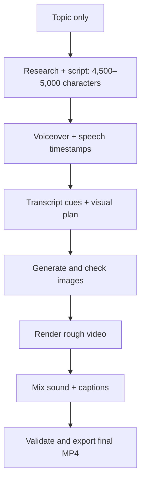

# Automated Educational Video Production System: MVP

## Objective

Build a Python production pipeline that takes only a topic and produces a finished, narrated educational video through API calls and deterministic rendering.

The AI must generate approximately **4,500–5,000 characters of narration**, including spaces, punctuation, and normalized line breaks. The system checks this length before generating speech. Video duration is determined by the generated audio; users do not supply a target duration.

The complete workflow is:

1. Research the topic and generate a narration script.
2. Generate voiceover audio with timing information.
3. Create a timestamped transcript and visual plan.
4. Generate one image for every transcript cue.
5. Assemble the rough video.
6. Finish sound, captions, and restrained camera movement.
7. Validate and export the final MP4.

Start with a command-line runner, one worker, one job at a time, and local files on a single computer. Model selection, voice, channel style, output settings, and credentials are configured once during setup rather than requested for every video.

The central design decision is that every stage reads and updates a production manifest. The manifest connects narration, timestamps, images, captions, and rendering.

## Architecture



Use provider APIs for unattended generation. The production pipeline must run independently of browser interfaces.

## MVP Scope

The first version accepts a topic, runs the complete pipeline, saves intermediate artifacts, and produces a final MP4, subtitles, and a basic validation report. It resumes interrupted jobs and retries failed generation requests within fixed limits.

Use one provider per generation task and fixed channel defaults. Keep image generation sequential initially. Reuse one character reference and maintain continuity within scene groups.

Later improvements can add a dashboard, SQLite-backed job management, concurrent workers, semantic image-quality scoring, advanced animation, sound-effect selection, and publishing integrations. These features are outside the first acceptance test.

## Recommended MVP Technology Stack

| Component | First implementation |
| --- | --- |
| Pipeline and workers | Python |
| Data validation | Pydantic |
| Job status and retries | Atomic updates to `manifest.json` and local job folders |
| Research, script generation, and visual planning | OpenAI Responses API |
| Voiceover and timing | ElevenLabs API |
| Image generation | Gemini image API |
| Labels and graphic overlays | Pillow with one simple text layout |
| Video and audio processing | FFmpeg and ffprobe |

## User Input and Fixed Defaults

The only per-video user input is:

```json
{
  "topic": "Who Watched the Baby While Ancient Humans Hunted?"
}
```

Store the following defaults in application configuration or prompt templates:

- English narration in a calm, second-person voice.
- The established ancient-human educational channel format and evidence standards.
- A narration length of 4,500–5,000 characters.
- The fixed doodle style, character reference, and 16:9 image aspect ratio.
- One configured model for each task and one configured narration voice.
- 1920×1080 video at 30 fps, with a separate subtitle file.
- Retry limits and an optional preconfigured local music track.

The AI chooses the central question and narrative angle from the supplied topic. The pipeline does not ask follow-up questions about style, voice, duration, or format.

## Stage 1: Research and Script Generation

### User Input

- Topic only.

### Processing

Use one bounded automated research pass to retrieve sources and save their URLs. Generate narration from the supported claims using the fixed channel prompt. Keep citations outside the spoken text. Research does not require an additional user input or approval step.

Return structured narration and source references. Validate source support separately from output structure. Assign stable paragraph and sentence IDs after the narration passes the length check.

The script should follow the established channel format: sensory hook, central question, evidence, reconstructed scene, surprising insight, modern connection, and closing callback. Distinguish observed behavior, hypotheses, and illustrative reconstructions.

### Script-Length Requirement

Include this instruction in the fixed script prompt:

> Given the topic, write an English narration script of approximately 4,500–5,000 characters, including spaces, punctuation, and line breaks. Use a calm, intelligent, second-person voice. Follow the channel's educational narrative structure and ground factual claims in the supplied research. Output narration without a title, headings, visual directions, or inline citations. Return source references separately. Choose the narrative angle yourself and do not ask the user for more information.

Count only the final narration text sent to the speech stage. Exclude JSON syntax, titles, source lists, IDs, and other metadata. Normalize line endings to `\n` and trim leading and trailing whitespace before counting:

```python
narration = narration.replace("\r\n", "\n").replace("\r", "\n").strip()
character_count = len(narration)
length_valid = 4500 <= character_count <= 5000
```

Count Unicode characters rather than bytes or tokens. Save and speak this same normalized text.

If the first draft falls outside the range, request one automatic length revision and count again. If it still fails, stop the job with a clear error before generating audio or images. Do not cut the text mid-sentence to meet the limit.

### Outputs

- `script.json`: structured narration with sentence IDs, source references, and the measured character count.
- `script.txt`: plain narration for speech generation.
- `sources.json`: source URLs and supported claims.

### References

- [OpenAI Structured Outputs](https://developers.openai.com/api/docs/guides/structured-outputs?api-mode=responses)
- [OpenAI web search](https://developers.openai.com/api/docs/guides/tools-web-search)

## Stage 2: Voiceover and Timing

### Inputs

- Final narration text.
- Voice and speech settings loaded from application configuration.

### Processing

Use the ElevenLabs speech-with-timing endpoint to obtain audio and character-level timestamps. Convert the character alignment into word and sentence timings. This can remove the separate speech-to-text step.

For the MVP, send the validated narration in one request if the selected model's input limit allows it. If its documented limit requires splitting, use natural paragraph chunks and calculate offsets from actual decoded audio durations after joining them.

Freeze speech timing after generation. If trimming, replacement, or other edits later change timing, align the known script against the final recording again. All later stages use the final audio's actual duration and alignment, without imposing a fixed video length.

### Outputs

- `narration.wav`: assembled final narration audio.
- `alignment.json`: character, word, and sentence timing information.

### References

- [ElevenLabs speech with timing](https://elevenlabs.io/docs/api-reference/text-to-speech/convert-with-timestamps/)
- [ElevenLabs Forced Alignment](https://elevenlabs.io/docs/overview/capabilities/forced-alignment)

## Stage 3: Transcript Cues and Visual Planning

### Inputs

- Structured script.
- Final audio alignment.
- Fixed channel visual style and the shared character reference.

### Processing

Segment aligned words into readable narration lines. Give each cue a permanent ID.

Choose cue boundaries from the actual speech and sentence structure. Do not impose the previous video's 81-cue count or a fixed transcript-line count. Every spoken word must belong to a cue.

Each cue needs:

- Spoken text and exact start/end times.
- Scene group and character IDs.
- Scene description.
- Required labels or numbers.
- Motion preset.

Enforce one final image file for every transcript cue.

Keep the fixed doodle style in code. Ask the model for scene-specific descriptions, then append the fixed style instructions automatically. Preserve continuity across consecutive cues in the same scene group.

### Outputs

- Timestamped transcript.
- Cue records in the production manifest.
- Image prompts and overlay instructions.

## Stage 4: Image Generation and Validation

### Inputs

- Cue prompts.
- Character reference images.
- Scene reference images.
- Fixed visual style and aspect-ratio settings.

### Processing

Generate the shared character reference automatically if it does not already exist, then reuse it. Consecutive cues in one scene group should also use that scene's reference image.

Generate cue images sequentially in the MVP and checkpoint each successful image. This keeps reference dependencies, retries, and recovery straightforward.

Check file validity, dimensions, and cue-to-image coverage. Retry failed or invalid images within a fixed limit. Preserve style through the fixed prompt and references; advanced semantic scoring and automated artistic review are later improvements.

Render names, percentages, and important labels as separate overlays using Pillow. Use one simple layout with text wrapping and bounds checks. This gives the system exact control over spelling and placement without requiring a general graphics engine.

### Outputs

- One approved image file per cue.
- Overlay assets where required.
- Image validation results and retry history.

### Reference

- [Gemini image generation](https://ai.google.dev/gemini-api/docs/image-generation)

## Stage 5: Rough Video Rendering

### Inputs

- Approved cue images and overlays.
- Final narration audio.
- Cue timings and motion presets.
- Output resolution and frame rate.

### Processing

Use FFmpeg to assemble approved images against the final narration. Calculate absolute frame boundaries, then derive each clip's duration from adjacent boundaries:

```python
start_frame = round(start_seconds * fps)
end_frame = round(next_start_seconds * fps)
duration_frames = end_frame - start_frame
```

Deriving durations from adjacent boundaries prevents accumulated rounding errors. Start the first visual at frame zero and hold the final image until the audio ends. Handle cues that would round to zero frames before rendering, preserving complete text coverage.

Use predefined movement rather than generating arbitrary animation instructions during rendering:

| Preset | Behavior |
| --- | --- |
| `hold` | Stationary image, useful for diagrams and text |
| `slow_push` | Gentle enlargement |

Limit the MVP to these two presets. Keep text-heavy scenes stationary.

### Outputs

- Rough video with synchronized narration.
- Render metadata and timing information.

## Stage 6: Sound and Caption Finishing

### Inputs

- Rough video and final narration.
- One optional local background music track configured during setup.
- Aligned words and subtitle settings.

### Processing

Automate narration loudness adjustment. If a music track is configured, loop or trim it to the video duration, mix it quietly under speech, and apply start/end fades and speech ducking. If no track is configured, produce a finished narration-only mix without requesting user input.

Generate subtitles from the same aligned words used for scene timing and preserve a separate `.srt` file. Caption burning, generated music, and automatic sound-effect selection can follow after the MVP.

### Outputs

- Finished video with mixed sound.
- Separate subtitle file.
- Audio measurements and finishing results.

### References

- [FFmpeg loudness normalization](https://ffmpeg.org/ffmpeg-filters.html#loudnorm)
- [FFmpeg sidechain compression](https://ffmpeg.org/ffmpeg-filters.html#sidechaincompress)

## Stage 7: Final Validation and Export

Before marking a job complete, check that:

- The narration contains 4,500–5,000 characters under the defined counting rule.
- Every cue has a valid image.
- Every frame of the timeline is covered.
- Audio and video durations match within one frame.
- Captions stay within the video duration.
- Required overlays fit inside the frame.
- The final video decodes successfully.
- Audio contains no clipping or unexpected long silence.

Failed checks should trigger bounded repair or produce a clear failure report.

### Outputs

- Final MP4.
- Subtitle file.
- Production manifest.
- Quality report and execution log.

## Production Manifest

The manifest is the MVP's source of truth for content, timing, execution status, attempts, input hashes, errors, and artifact locations. Each job has its own local folder. A single worker writes updates atomically so an interrupted save does not destroy the last valid checkpoint.

The following is an illustrative cue record:

```json
{
  "job_id": "video_001",
  "topic": "Who Watched the Baby While Ancient Humans Hunted?",
  "script_character_count": 4750,
  "fps": 30,
  "audio_path": "audio/narration.wav",
  "cues": [
    {
      "id": "cue_0001",
      "text": "You hear your baby cry.",
      "start_ms": 0,
      "end_ms": 1000,
      "scene_group": "camp_opening",
      "image_path": "images/cue_0001.png",
      "start_frame": 0,
      "end_frame": 30,
      "motion": "hold",
      "overlay_text": null
    }
  ]
}
```

The character count and timings above are illustrative. Actual values come from the normalized narration and final audio alignment.

## Recovery, Caching, and Cost Control

Build recovery into the first version:

- Save each successful result immediately.
- Cache results using hashes of inputs, prompts, model settings, and references.
- Retry temporary API failures with backoff.
- Process images sequentially and respect provider rate limits.
- Use fixed retry limits and record provider usage. Apply a configured spending ceiling where usage can be priced reliably.
- Regenerate only failed or changed assets.
- Resume unfinished work after restarting.

For example, if image 47 fails, the job should retain images 1–46 and the completed voiceover.

## Reuse Existing Workspace Work

The existing [video builder](/D:/duc/startUp/yt/who_watched_the_baby_video/build_project.py:21) already handles image timing, subtitles, camera movement, and Kdenlive project output.

Generalize its fixed audio path and fixed count of 81 images. Reuse its timing calculations and subtitle generation. Load inputs from each job's manifest and derive duration from the actual audio. Add an FFmpeg renderer that produces the finished MP4 without opening an editor.

Keep the existing Kdenlive export available separately; the MVP acceptance test requires only the direct MP4 render and subtitles.

## Implementation Order

| Phase | Deliverable |
| --- | --- |
| 1. Existing assets to finished MP4 | Command-line rendering, narration mixing, optional music, subtitles, and basic validation |
| 2. Transcript to images | Sequential image generation, shared reference, basic checks, checkpoints, and retries |
| 3. Script to timed audio | ElevenLabs generation and alignment using fixed voice settings |
| 4. Topic to script | Topic-only input, bounded research, a 4,500–5,000-character draft, and one length-repair attempt |
| 5. Full MVP proof | One unattended topic-to-video run, interruption recovery, and saved artifacts |

This order proves the final production stages using assets that already exist, then adds generation stages incrementally.

## MVP Acceptance Test

First use a short existing fixture to prove the renderer in isolation. Then run the full pipeline using only a topic. The full run must generate 4,500–5,000 characters of narration and render its complete audio duration; it is not limited to a 60–90 second video.

The test passes when:

1. The only per-video user input is the topic; the pipeline requires no manual browser steps or follow-up questions.
2. The normalized narration contains 4,500–5,000 characters, including spaces, punctuation, and normalized line breaks, before speech generation starts.
3. The pipeline produces a playable final MP4 with complete narration, cue images, sound finishing, and a separate subtitle file.
4. Every transcript cue has a corresponding image, all spoken text is covered, and timeline coverage is complete.
5. Audio and video durations match within one frame, using the final recording's actual duration.
6. Interrupting and restarting the job preserves completed work.
7. A failed image can be retried without regenerating successful images or voiceover.
8. Execution respects configured retry limits, records usage, and produces a basic validation report.
